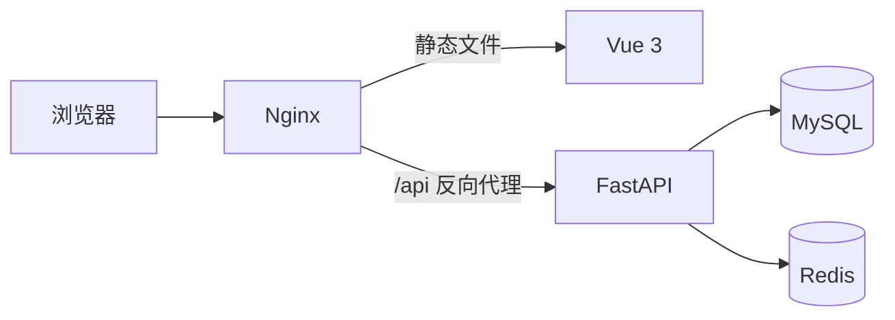

# Toutiao News

[](https://github.com/ZuoXing-0504/pythonweb-toutiao_news/actions/workflows/ci.yml)


一个基于 FastAPI 与 Vue 3 的前后端分离新闻资讯平台。项目包含用户认证、新闻浏览、收藏和历史记录，并围绕数据库迁移、并发一致性、缓存降级、自动化测试、持续集成与容器化部署进行了完整的后端工程化实践。

## 系统架构



生产环境仅对外暴露 Nginx。FastAPI、MySQL 和 Redis 通过 Docker 内部网络通信，数据库与缓存端口不会直接暴露到公网。

## 功能

- 用户注册、登录、Token 身份认证、资料维护和密码修改
- 新闻分类、分页列表、详情、浏览量和相关新闻
- 新闻收藏状态检查、添加、删除、分页列表和清空
- 浏览历史添加、删除、分页列表和清空
- 中英文界面和主题设置

## 工程亮点

- **异步后端**：使用 FastAPI、SQLAlchemy Async 和 aiomysql 构建异步 API 与数据库访问层。
- **接口契约**：使用 Pydantic 统一请求校验、响应模型、camelCase 字段与异常响应。
- **数据库迁移**：通过 Alembic 管理初始表结构和后续约束变更，容器启动时自动执行迁移。
- **并发一致性**：通过数据库唯一约束、事务回滚和幂等写入，避免并发请求产生重复收藏、历史记录和 Token。
- **缓存降级**：新闻分类与分页结果采用 Cache Aside 模式；Redis 不可用时自动回退 MySQL，空结果使用短 TTL 降低缓存穿透风险。
- **可观测性**：记录请求 ID、HTTP 状态码和接口耗时，并输出结构化日志。
- **自动化验证**：当前包含 18 个单元测试和 2 个真实 MySQL/Redis 集成测试，覆盖认证、分页、事务回滚、并发写入和缓存降级等场景。
- **持续集成**：GitHub Actions 自动执行后端单元测试、MySQL/Redis 集成测试、前端构建与 Docker 构建检查。
- **容器化部署**：使用 Docker Compose 编排 FastAPI、MySQL、Redis 和 Nginx，包含健康检查、数据卷与 HTTPS 配置模板。

## 技术栈

| 分类 | 技术 |
| --- | --- |
| 后端 | Python 3.12、FastAPI、SQLAlchemy 2.0 Async、Pydantic |
| 数据 | MySQL 8.0、Redis 7、Alembic、aiomysql |
| 前端 | Vue 3、Vite、Pinia、Vue Router、Vant |
| 测试 | Pytest、pytest-asyncio、HTTPX、SQLite、MySQL、Redis |
| 工程 | Docker Compose、Nginx、GitHub Actions、结构化日志 |

## 项目结构

```text
.
├── toutiao_backend/          # FastAPI 后端
│   ├── alembic/              # 数据库迁移
│   ├── cache/                # 新闻缓存策略
│   ├── config/               # 数据库、Redis 与集中配置
│   ├── crud/                 # 数据访问与事务逻辑
│   ├── models/               # SQLAlchemy ORM 模型
│   ├── routers/              # API 路由
│   ├── schemas/              # Pydantic 请求/响应模型
│   ├── scripts/              # 演示数据初始化
│   ├── tests/                # 单元测试与集成测试
│   └── utils/                # 认证、异常、响应与日志
├── xwzx-news/                # Vue 3 前端
├── deploy/nginx/             # HTTPS Nginx 模板
├── compose.yaml              # 基础服务编排
├── compose.prod.yaml         # 生产前端与 Nginx
└── compose.https.yaml        # HTTPS 覆盖配置
```

## 快速开始

### 环境要求

- Docker Desktop 或 Docker Engine
- Docker Compose 2.x
- Node.js 22（仅前端开发需要）

### 1. 配置环境变量

在仓库根目录复制模板：

```bash
cp .env.example .env
```

Windows PowerShell：

```powershell
Copy-Item .env.example .env
```

至少修改以下数据库密码：

```dotenv
MYSQL_ROOT_PASSWORD=replace_with_a_local_root_password
MYSQL_DATABASE=news_app
MYSQL_USER=news_user
MYSQL_PASSWORD=replace_with_a_local_database_password
```

### 2. 启动后端、MySQL 和 Redis

```bash
docker compose up -d --build
docker compose ps
```

容器会等待 MySQL 和 Redis 健康后自动执行 `alembic upgrade head`，然后启动 FastAPI。

- API 文档：<http://127.0.0.1:8000/docs>
- OpenAPI：<http://127.0.0.1:8000/openapi.json>

### 3. 初始化演示数据

```bash
docker compose exec api python -m scripts.seed_data
```

该命令会补齐 8 个新闻分类和 8 条演示新闻，并清理新闻缓存；重复执行不会重复插入。

### 4. 启动前端开发服务器

```bash
cd xwzx-news
cp .env.example .env
npm ci
npm run dev
```

Windows PowerShell 可使用 `Copy-Item .env.example .env`。默认前端地址为 <http://127.0.0.1:5173>，API 地址为 <http://127.0.0.1:8000>。

### 5. 停止服务

```bash
docker compose down
```

该命令会保留 MySQL 与 Redis 数据卷。`docker compose down -v` 会删除数据卷，请仅在确定需要重置数据时使用。

## 自动化测试

安装开发依赖：

```bash
cd toutiao_backend
pip install -r requirements-dev.txt
```

运行不依赖外部服务的单元测试：

```bash
python -m pytest -m "not integration" -q
```

集成测试使用真实 MySQL 与 Redis，由 GitHub Actions 自动准备隔离服务并执行：

```bash
python -m pytest -m integration -q
```

本地运行集成测试前需要配置 `TEST_DATABASE_URL` 和 `TEST_REDIS_URL`，不要指向包含重要数据的数据库。

## 数据库迁移

在 `toutiao_backend` 目录执行：

```bash
alembic upgrade head
```

创建新迁移：

```bash
alembic revision --autogenerate -m "describe_change"
```

生产部署不应使用 `Base.metadata.create_all()` 代替迁移，也不应随意执行 `alembic stamp head` 跳过真实结构变更。

## 生产部署

HTTP 部署使用基础配置和生产覆盖配置：

```bash
SERVER_NAME=news.example.com \
docker compose -f compose.yaml -f compose.prod.yaml up -d --build
```

生产模式由 Nginx 托管 Vue 构建产物，并把 `/api`、`/docs` 和 `/openapi.json` 转发给 FastAPI。SPA 路由通过 `try_files` 回退到 `index.html`。

配置域名、DNS、80/443 端口和 TLS 证书后，可启用 HTTPS：

```bash
SERVER_NAME=news.example.com \
docker compose -f compose.yaml -f compose.prod.yaml -f compose.https.yaml up -d --build
```

证书默认放置在：

```text
deploy/certbot/conf/live/news.example.com/fullchain.pem
deploy/certbot/conf/live/news.example.com/privkey.pem
```

证书、私钥、`.env` 和其他本地密钥文件不会提交到仓库。

## 安全说明

- 不要把真实密码、数据库连接串、第三方 API Key 或证书提交到 Git。
- 生产环境应使用随机数据库密码、HTTPS 和最小范围的云安全组规则。
- 如果密钥曾出现在前端、日志、聊天记录或 Git 历史中，应立即作废并重新生成。
